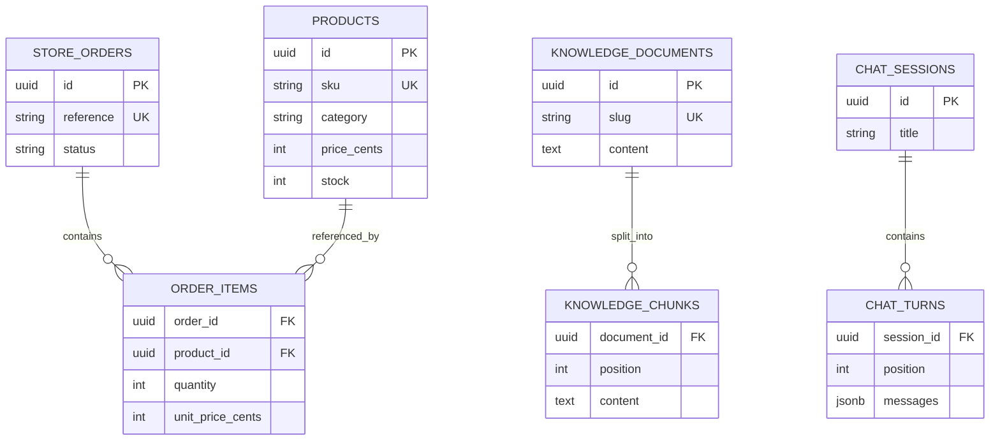

# 02 — Database tables, constraints, migrations, and dummy data

## Why use a relational database here?

Products have fixed fields: SKU, price, stock, category. Orders have line items pointing to products. Conversations have ordered turns. PostgreSQL can store these relationships and enforce rules while retaining data when the API process restarts.

A Python list disappears when its process exits. A database commit persists independently of the API's memory. We use the existing `app_playground` schema so this experiment remains separate from the monorepo's other apps.

A PostgreSQL **schema** is a namespace inside a database. It is different from a Pydantic request schema or a tool's JSON Schema, despite the shared word. In this repository, schemas organize tables; they are not a security boundary between apps using the same database role.

## The relationships



The original `runs` table remains separate for echo experiments.

## Read a model declaration slowly

This is an excerpt from `models.py`:

```python
class Product(Base):
    __tablename__ = "products"
    __table_args__ = (
        CheckConstraint("price_cents >= 0", name="product_price_nonnegative"),
        CheckConstraint("stock >= 0", name="product_stock_nonnegative"),
    )

    id: Mapped[UUID] = mapped_column(primary_key=True, default=uuid4)
    sku: Mapped[str] = mapped_column(String(40), unique=True)
    name: Mapped[str] = mapped_column(String(200))
    category: Mapped[str] = mapped_column(String(80), index=True)
    description: Mapped[str] = mapped_column(Text)
    price_cents: Mapped[int]
    stock: Mapped[int]
```

`Base` connects the Python class to SQLAlchemy's declarative mapping. Its metadata specifies `schema="app_playground"` for the mapped tables. `__tablename__` supplies the SQL table name. `Mapped[...]` tells SQLAlchemy and type tools that an attribute represents a mapped database value.

`mapped_column(...)` supplies database options. For `price_cents` and `stock`, SQLAlchemy infers an integer column from `Mapped[int]`. These non-optional annotations produce non-null columns. The generated Alembic migration makes the resulting SQL schema explicit.

`default=uuid4` is a Python-side default: SQLAlchemy calls the function when inserting a new object without an ID. It is not a PostgreSQL default for arbitrary SQL clients. In contrast, `server_default=func.now()` on timestamps is a database-side default.

A primary key uniquely identifies a row. The unique SKU is a readable business identifier. Keeping both means relationships use stable UUIDs while users and tools can use names like `BOOT-001`.

## Why money is integer cents

Binary floating-point cannot represent every decimal fraction exactly. For an item price, we want exact addition and multiplication. We store $129.99 as the integer `12999`.

The order tool calculates totals directly from integers:

```python
"line_total_cents": item.quantity * item.unit_price_cents
```

For `TRAIL-1001`:

```text
1 × 12999 + 2 × 2999 = 18997 cents = $189.97
```

This is a merchandise total. We have not implemented taxes, shipping charges, payments, discounts, or checkout. The currency is explicitly USD. Integer cents suit this one-currency example; some currencies use different minor-unit conventions.

Order items keep the **unit price at purchase**. A product's current price can change without rewriting what an earlier order cost. This is why `TENT-001` costs 19999 cents now while a seeded order item records 18999 cents.

## Constraints are checks PostgreSQL enforces

HTTP validation cannot be the only source of truth. Another script could write to the database without passing through FastAPI. Database constraints reject invalid values regardless of the caller:

- Nonnegative product stock and price.
- Positive order quantities and nonnegative order prices.
- A known order status: processing, shipped, or delivered.
- Unique SKU, order reference, and document slug.
- Unique `(order_id, product_id)`, `(document_id, position)`, and `(session_id, position)` pairs.
- Foreign keys that require the referenced product, order, document, or session to exist.

`ondelete="CASCADE"` for document chunks means deleting a document also deletes its chunks. The same rule applies to an order's items and a session's turns. A product referenced by an order item is not silently deleted; that relationship has no cascading delete.

Indexes on category and foreign-key lookup fields help the corresponding filters. A normal category index does not make a `%keyword%` substring search fast. For this tiny store we accept scans; at larger scale you would choose an appropriate full-text or trigram index.

## How Python reaches PostgreSQL

`database.py` creates an engine and a session factory:

```python
engine = create_engine()
Session = async_sessionmaker(engine, expire_on_commit=False)

async def get_session():
    async with Session() as session:
        yield session
```

The engine manages pooled connections. Creating it does not create tables or immediately open every possible connection. The session is a unit of work: it tracks ORM objects and coordinates SQL operations within a transaction. FastAPI opens one session per request and closes it afterward.

`expire_on_commit=False` lets already-loaded attributes remain available after commit. Otherwise, accessing an expired attribute can require a fresh database query, which is awkward during async response serialization. We still explicitly refresh new turns to load database-generated defaults before returning them.

### A query is an expression before it is SQL

The product lookup builds an expression:

```python
select(Product).where(Product.sku == args.sku)
```

SQLAlchemy compiles that expression to SQL appropriate for PostgreSQL. The SKU travels as a bound parameter, separate from the SQL structure. Conceptually:

```sql
SELECT ... FROM app_playground.products WHERE sku = :sku;
```

`:sku` is explanatory placeholder notation; the actual driver's placeholder syntax can differ. The model never supplies a complete SQL statement. It supplies an argument that the application places in a predetermined query.

`await session.scalar(...)` obtains the first scalar result, which here is a mapped Product object or `None`. `await session.scalars(...)` produces a collection of mapped objects. `session.execute(...)` returns rows, which is useful when each row contains both an order item and its product.

### What PostgreSQL does

The driver sends a query and parameters using PostgreSQL's wire protocol. PostgreSQL parses and plans the query, chooses a way to read rows, and executes it under the transaction's visibility rules. A useful index can avoid examining every row. Rows live in database pages; buffers can cache pages in memory, and persistent storage backs the database.

PostgreSQL returns typed values. The driver decodes them. SQLAlchemy maps the values into Python objects. `product_data` then turns an object into a plain dictionary suitable for JSON. These are separate steps; a Product object is not itself the JSON text the model receives.

## What migrations do

Changing `models.py` does not change an existing database. Migration `0002` creates the store, knowledge, and chat tables on top of the original `0001` run table.

```bash
make migrate APP=playground
make check APP=playground
```

The migration contains operations such as:

```python
op.create_table(
    "products",
    sa.Column("id", sa.Uuid(), nullable=False),
    # Other columns and constraints are in the actual migration.
    schema="app_playground",
)
```

This fragment is shortened; the complete migration is in the source companion. Alembic stores the revision in this app's `alembic_version` table. `upgrade head` runs unapplied revisions in dependency order. `check` compares the models with the current database to identify drift.

For a later model change, generate and inspect a new migration:

```bash
make revision APP=playground MESSAGE="describe the change"
make migrate APP=playground
make check APP=playground
```

A downgrade removes tables defined by this migration. It also removes their data. Practice downgrade/upgrade in a disposable database, not the seeded conversation database you want to keep.

## Why the seed is repeatable

The seed inserts 12 products, 3 orders, 6 order items, and 6 knowledge documents. With the default 120-word/30-word-overlap chunking, those documents produce 11 chunks. It intentionally creates no fake chat history.

The product insertion uses PostgreSQL's conflict handling:

```python
insert(Product).values(
    id=seed_id(f"product:{sku}"),
    sku=sku,
    name=name,
    category=category,
    description=description,
    price_cents=price,
    stock=stock,
).on_conflict_do_nothing(index_elements=[Product.sku])
```

If the SKU already exists, PostgreSQL skips that insertion. Existing stock, prices, and descriptions are preserved. The seed looks up natural keys before creating order lines, so a preexisting product with a different UUID is still referenced correctly.

`seed_id` uses UUID version 5:

```python
def seed_id(key: str) -> UUID:
    return uuid5(SEED_NAMESPACE, key)
```

The same namespace and input string generate the same ID. This is convenient for fictional fixtures; it is not a secret or an authentication token. Ordinary application records use random UUID version 4 IDs.

The entire seed runs inside `Session.begin()`. Successful completion commits all seed changes. An exception rolls back that invocation. Knowledge documents already present are skipped so repeated runs do not regenerate chunk IDs or overwrite manual edits.

Next: [tool calling](03-tool-calling.md).
