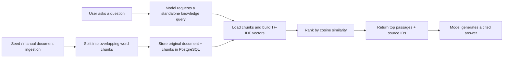

# 05 — RAG, explained down to word counts and vector arithmetic

## What RAG does in this app

Suppose the user asks whether boots can be returned after outdoor use. The model's general training does not contain our fictional store policy. We retrieve passages from the store's own documents, put them in a tool message, and ask the model to answer from that evidence.

The three parts are:

```text
Retrieval: find the relevant returns passage.
Augmentation: add its text and citation to the model's messages.
Generation: let the model write an answer using that passage.
```

RAG does not require a neural vector database. This implementation uses TF-IDF vectors based on word counts. It is **lexical** retrieval: words shared by the query and a passage create similarity. The generative model can understand the passage, but retrieval itself does not learn semantic meaning.

There are two stages with different timing:



## Stage 1: ingestion

`ingest_document` takes `slug`, `title`, `content`, and `source`. A slug is the stable human-readable identity, such as `returns`. The document row retains the full content; its chunk rows retain parts useful for retrieval.

For a new document, we insert it and flush to obtain its ID. For an existing slug, we update its fields, delete its old chunks, and insert a new chunk set. The caller owns the transaction, so a failure cannot leave a half-replaced document committed.

```python
session.add_all(
    KnowledgeChunk(document_id=document.id, position=position, content=text)
    for position, text in enumerate(chunk_text(content))
)
await session.flush()
```

A chunk stores text, not a neural embedding. This implementation computes word vectors when retrieval runs. That avoids an index cache that could become stale after a document changes. It is a simple but intentionally limited scaling choice.

## Why split documents?

Sending the entire knowledge base to the model wastes context and can obscure relevant evidence. Smaller passages give retrieval more focused units and allow the model to see only the best candidates.

Cutting text can also separate a rule from an important condition. Overlap reduces that risk by repeating part of one chunk in the next. Here chunks have 120 whitespace-separated words and overlap by 30:

```python
def chunk_text(text: str, size: int = 120, overlap: int = 30) -> list[str]:
    if size < 1 or not 0 <= overlap < size:
        raise ValueError("Require size > 0 and 0 <= overlap < size")
    words = text.split()
    chunks = []
    for start in range(0, len(words), size - overlap):
        chunks.append(" ".join(words[start : start + size]))
        if start + size >= len(words):
            break
    return chunks
```

`size - overlap` is the stride, here 90. With 250 words, the ranges are:

```text
chunk 0: words   0 .. 119
chunk 1: words  90 .. 209
chunk 2: words 180 .. 249
```

The loop stops as soon as a chunk reaches the end. It does not produce an extra trailing chunk that is entirely contained in the preceding chunk.

These are words, not model tokens. The chunker normalizes whitespace and does not understand paragraphs, sentences, code blocks, or Markdown structure. A sentence-aware splitter would improve boundary quality, but this implementation makes the mechanics transparent.

## Stage 2: prepare candidate texts

`retrieve_knowledge` joins chunk rows to document metadata and orders them by slug and chunk position. It fetches at most 1001 rows so it can detect that the learning corpus exceeded its 1000-chunk limit. If so, it returns a capacity error rather than silently searching a truncated subset.

For ranking, the candidate text includes the title:

```python
texts = [f"{document.title}\n{chunk.content}" for chunk, document in rows]
```

The returned `content` is still the stored chunk. Repeating the title in the ranking input helps short queries such as “warranty,” though it also influences word frequencies. The corpus for the following math is the set of candidate **chunks**, not the number of original source documents.

## Step A: tokenize for lexical retrieval

The tokenizer is intentionally different from the LLM's tokenizer:

```python
def tokenize(text: str) -> list[str]:
    return [word for word in re.findall(r"[a-z0-9]+", text.lower()) if word not in STOP_WORDS]
```

It lowercases the text, extracts ASCII letter/digit sequences, and removes a small list of frequent words. For example:

```text
"The BOOTS are unused!" -> ["boots", "unused"]
```

No stemming turns “returns” into “return.” No synonym system makes “refund” equal “money back.” The English/ASCII tokenizer is also a limitation for multilingual text. These restrictions are useful to understand before attributing intelligence to the retrieval step.

## Step B: count occurrences

We build a `Counter` for each candidate:

```python
counts = [Counter(tokenize(text)) for text in texts]
```

For this tiny artificial corpus:

```text
A: "boots boots returns"
B: "tent returns"
query: "boots returns"
```

The counts are:

```python
A = {"boots": 2, "returns": 1}
B = {"tent": 1, "returns": 1}
query = {"boots": 1, "returns": 1}
```

We also count how many candidates contain each term at least once:

```python
document_frequency = Counter(word for count in counts for word in count)
```

Iterating over a `Counter` yields its keys, so a term contributes once per candidate regardless of repeated occurrences within that candidate.

```text
df(boots) = 1
df(tent) = 1
df(returns) = 2
N = 2 candidates
```

## Step C: inverse document frequency

A word found in every candidate distinguishes them less than a rare word. The implementation uses smoothed IDF:

```text
idf(term) = ln((1 + N) / (1 + df(term))) + 1
```

The `+1` values smooth the calculation; the final `+1` keeps weights positive. In our example:

```text
idf(boots)   = ln(3/2) + 1 ≈ 1.4055
idf(tent)    = ln(3/2) + 1 ≈ 1.4055
idf(returns) = ln(3/3) + 1 = 1
```

IDF depends on the corpus. Adding documents can change rankings even when the old text stays the same. Overlapping chunks are separate candidates, so repeated words in adjacent chunks also affect their document frequency.

## Step D: term frequency and sparse vectors

We weight repeated occurrences using logarithmic term frequency:

```text
tf(term) = 1 + ln(count(term))
weight(term) = tf(term) × idf(term)
```

A repeated word receives more weight, but not twice the weight merely because it appears twice. For A, `boots` gets `(1 + ln 2) × 1.4055 ≈ 2.3797`.

Imagine vector coordinates ordered as `[boots, returns, tent]`:

```text
A = [2.3797, 1.0000, 0.0000]
B = [0.0000, 1.0000, 1.4055]
Q = [1.4055, 1.0000, 0.0000]
```

A dense representation writes every zero explicitly. Our code instead uses a dictionary for nonzero weights:

```python
weights = {
    word: (1 + math.log(frequency)) * idf[word]
    for word, frequency in count.items()
    if word in idf
}
```

That is a **sparse vector**. Each word is a coordinate. The dictionary keys define those coordinates consistently across documents and the query. Unlike neural embeddings, the axes are directly interpretable.

## Step E: normalize and calculate cosine similarity

The Euclidean length of a vector is:

```text
norm(v) = sqrt(sum(v_i²))
```

We divide each component by that norm:

```python
norm = math.sqrt(sum(weight * weight for weight in weights.values()))
return {word: weight / norm for word, weight in weights.items()} if norm else {}
```

For the example, approximate normalized vectors are:

```text
 ≈ [0.9219, 0.3874, 0]
B̂ ≈ [0, 0.5797, 0.8148]
Q̂ ≈ [0.8148, 0.5797, 0]
```

The dot product of normalized vectors is their cosine similarity:

```text
cos(Q, A) ≈ 0.8148 × 0.9219 + 0.5797 × 0.3874 ≈ 0.976
cos(Q, B) ≈ 0 + 0.5797 × 0.5797 + 0 ≈ 0.336
```

A ranks above B because it shares both query terms. In code:

```python
score = sum(weight * doc_vector.get(word, 0) for word, weight in query_vector.items())
```

`.get(word, 0)` makes missing coordinates contribute zero. Normalization compares direction, rather than rewarding a document simply for having more words. Floating-point rounding can produce tiny numerical deviations around exact mathematical limits.

## Step F: choose results

The code discards zero-similarity candidates, sorts remaining candidates by descending score, and uses candidate index as a deterministic tie-breaker:

```python
return sorted(scores, key=lambda pair: (-pair[1], pair[0]))[:limit]
```

The tool defaults to the top three and permits at most five. A positive score is a lexical match, not a probability that the passage answers the question. We do not apply a calibrated relevance threshold or a reranker.

Unknown query words are ignored because they do not belong to the corpus vocabulary. If every query word is unknown, or removed as a stop word, the query vector is empty and retrieval returns no matches. If a query mixes known and unknown words, its score is based only on the known part; that can overstate relevance. This is another reason the model must read the evidence rather than trust the score as a confidence percentage.

## Step G: augment the model request

Each result includes a traceable label:

```python
{
    "citation": f"store:{document.slug}#{chunk.position}",
    "title": document.title,
    "source": document.source,
    "content": chunk.content,
    "score": round(score, 6),
}
```

`store:returns#0` means chunk 0 of the document whose slug is `returns`. It is a citation label, not an automatically resolvable HTTP URL. You can inspect the returned chunk in `tool_events` and the full document in `/knowledge/documents`.

The agent's tool-result message carries this object back to the model. The next generation can use the policy text to answer “Outdoor-worn boots are considered used,” with the corresponding citation.

That is the augmentation step. The retrieved text is present in the next model input. We do not modify weights, fine-tune the model, or copy the whole database into training data.

## Follow-ups need a useful retrieval query

“Can I return them?” is understandable in a conversation but weak as a standalone lexical query. The tool description tells the model to rewrite follow-ups using history:

```text
conversation-aware question -> "returns boots worn outdoors"
```

This rewrite is a model decision, not a separate deterministic rewriting component. The direct `/knowledge/search` endpoint does no conversation rewriting. When debugging a bad answer, inspect the actual tool query before blaming the chunker or scorer.

## What citations do and do not establish

A citation connects an answer to an identifiable retrieved passage. It does not prove the model quoted accurately, chose the right passage, or applied every exception correctly. This version asks for citations but does not mechanically validate them after generation.

Document replacement can also change what `store:returns#0` refers to in the current corpus. Saved turn events retain the old retrieved text, so you can still inspect evidence used at answer time. For durable citations across document revisions, add version IDs or content hashes.

Retrieved content and web snippets are untrusted data. The system prompt instructs the model to ignore instructions embedded in them. That prompt is a behavioral defense, not a guarantee against prompt injection. The actual execution boundary remains the allowlisted read-only tools and their validated parameters.

## Why not start with neural embeddings?

An embedding model maps a passage into a dense learned vector. Similar language can lie near similar language even without exact shared words. That can improve recall for paraphrases, but adds model choice, vector storage, index consistency, dimension checks, and another operation to understand.

TF-IDF exposes the full retrieval calculation in this app. Once you can explain its failure cases, replacing it with or combining it with semantic embeddings becomes a specific engineering decision. Chapter 08 outlines that extension.

Next: [trace a full request](06-trace-a-request.md).
